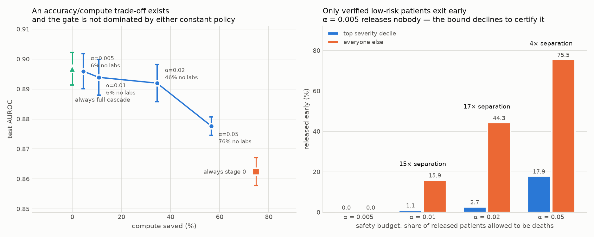

# Early-Exit Models for Clinical Risk Stratification

Adaptive-inference models for ICU mortality prediction on MIMIC-IV v3.1, built around one question: **when is it safe to stop computing and commit to an answer for this patient?**

Cohort: 17,663 first ICU stays, first-24h features, in-hospital mortality (prevalence 10.8%).

## Data

This project is built on **MIMIC-IV v3.1, which is credentialed data under the [PhysioNet Data Use Agreement](https://physionet.org/content/mimiciv/)**. No patient-level data is in this repository and none ever should be: the raw tables, extracted cohorts and cached feature blocks are all gitignored. Only aggregate results (metric tables, figures) are committed, which the DUA permits.

To reproduce, obtain your own MIMIC-IV credentials and point `data.raw_dir` at your copy.

## Latest: graph v2 — can a graph/neural model beat XGBoost? (notebooks 12–18)

Goal: beat XGBoost, target test AUROC > 0.91, without stacking with XGBoost. Everything below is on the same core test split and seeds 42–44. "best-data" adds the 28,988 patients the cohort drops only because the Kaggle mirror's `chartevents` is truncated (training only) plus 252 within-window trajectory features. Full record: **[`GRAPH_V2_RESULTS.md`](GRAPH_V2_RESULTS.md)**.

| model | original data | best-data |
|---|---|---|
| XGBoost, phase-1 config | 0.8939 ± 0.0015 | 0.9006 ± 0.0034 |
| XGBoost, tuned | 0.9034 ± 0.0025 | **0.9082 ± 0.0040** |
| 3-stage cascade | 0.9012 ± 0.0045 | 0.9057 ± 0.0039 |
| Arch4R `encoder_only`, corrected | 0.8919 ± 0.0048 | — |
| Arch4R `adaptive_k` (phase 1, 5 seeds) | 0.8925 ± 0.0038 | — |
| **Graph v2 encoder** (cross-fitted multi-view MLP) | 0.9013 ± 0.0022 | **0.9063 ± 0.0009** (best run 0.9080) |
| Graph v2 G1 — label-aware retrieval | 0.8995 ± 0.0016 | 0.9047 ± 0.0012 |
| **Graph v2 best: pretrained encoder ⊕ G1 retrieval** | — | **0.9082 ± 0.0023** (best run 0.9099) |

- **Correction to phase 1:** its `encoder_only` arm took only 5 optimizer steps. Trained properly it reaches 0.8919, so the "+0.1468 graph signal" below was an undertraining artifact.
- The best model (self-supervised-pretrained encoder + label-aware retrieval, no XGBoost anywhere) beats every original baseline, including the cascade, and **ties tuned XGBoost given identical data** (0.9082 vs 0.9082). Nothing clears 0.91 on the 3-seed mean.
- Graph signal appears only with pretraining. Without it, retrieval, masked-label PPR and Correct & Smooth added nothing over a well-trained encoder. With a pretrained encoder, the retrieval exit adds +0.0015 on every seed.
- Paused until a non-truncated MIMIC-IV source is available.

## Architecture 4R

The previous line of work. A weak multi-view encoder, a **density-adaptive** per-view patient-similarity graph (every prior graph in this project used fixed-k feature-kNN), checkpointed local-push diffusion, and a certified (Clopper-Pearson) low-risk-only stopping gate — aimed at closing the measured AUROC gap between the project's one positive graph result (Architecture 2, below) and the tabular cascade. Full technical record, including the bugs found and fixed getting it running on real GPU hardware, is in **[`ARCH4R_HANDOVER.md`](ARCH4R_HANDOVER.md)**.

**Phase 0 (integrity/replication gate): PASSED**, on the real 17,663-patient cohort — reproduced Architecture 2's diffusion gain at +0.0248 to +0.0266 across runs (recorded band: [+0.0041, +0.0373]).

**Phase 1 (the graph-and-gate experiment)**: runs all 8 arms below — 3 of them (`cascade_3stage`, `plain_xgboost`, `architecture2`) are the prior architectures, kept solely as comparison baselines, not as separate lines of work anymore. Real 5-seed result on the real cohort:

| arm | test AUROC, mean ± SD (n=5) |
|---|---|
| plain_xgboost (baseline) | 0.8962 ± 0.0032 |
| cascade_3stage (baseline) | 0.9015 ± 0.0053 |
| graph_free_encoder (baseline) | 0.8572 ± 0.0134 |
| arch2_diffusion (baseline) | 0.8852 ± 0.0044 |
| arch4r_encoder_only | 0.7457 ± 0.0479 |
| arch4r_fixed_k | 0.8917 ± 0.0049 |
| **arch4r_adaptive_k** | **0.8925 ± 0.0038** |
| arch4r_adaptive_k_certified | 0.8887 ± 0.0059 (61.1% ± 3.9% compute saved) |

**Overall verdict: NO-GO for Phase 2 on the pre-registered criteria.** Phase 1 reported `arch4r_adaptive_k` beating `arch4r_encoder_only` by +0.1468 AUROC (t=7.30, p=0.0019). **Superseded by graph v2:** that encoder arm was undertrained (5 optimizer steps). Trained properly it reaches 0.8919, so the real gap is ≈ +0.0006, not evidence of graph signal. It does not yet significantly beat `arch4r_fixed_k` (+0.0009, not significant), and the certified low-risk policy saves compute well past its 30% bar (61.1%) but costs slightly more accuracy (0.39%) than its strict 0.2% bar allows. Full detail, including per-seed numbers and what would need to change, in `ARCH4R_HANDOVER.md`.

## Prior architectures — now comparison baselines only

Everything below was this project's own line of work before Architecture 4R, in order. Each is now used **only** as a comparison arm against Architecture 4R (see the table above), not as active research.

**The staged hybrid cascade** (notebook `08`) cascades over *information* rather than model depth — bedside vitals, then charted orders, then the lab panel — since clinical data doesn't arrive at once or at equal cost. At a 2% safety budget: 34.5% of compute saved, 46.2% of patients resolved without reading the lab block, 0.0081 realised miss rate. The main negative result from this line: a patient-similarity graph built from the feature matrix itself adds nothing on top of the boosted score (best variant: +0.0001 AUROC for a stage costing 5x the tabular stages combined).

**Architecture 1 (Graph-ACT / EEGNN)**, **Architecture 2 (PPR-Push)**, and **Architecture 3 (Fixed-Block)** are three structurally different early-exit mechanisms tested in a controlled experiment (`old/ARCHITECTURES.md`) against the same cohort/graph/gate. Architectures 1 and 3 both show flat per-exit accuracy (early exit buys nothing); Architecture 2 is the exception — its stages genuinely differentiate (+0.0207 AUROC, t=5.61) because its first stage is a graph-free encoder and each diffusion round adds real information. That's the finding Architecture 4R builds on directly.

Full technical record for all of this (including the negative results, the reproduction pass, and every correction made along the way) is in **[`old/HANDOVER.md`](old/HANDOVER.md)**; the three-architecture controlled experiment is in **[`old/ARCHITECTURES.md`](old/ARCHITECTURES.md)**.



## Layout

```
src/graph_v2.py           graph v2: encoder, G1 retrieval, cross-fitting, leak-free C&S, PLR, pretraining
src/temporal_block.py     within-window trajectory features (6 h bins, slope, recency)
GRAPH_V2_RESULTS.md        numbers of record for every baseline and every model (notebooks 12-18)
src/arch4r.py             Architecture 4R model (encoder + density-adaptive graph + diffusion + gate)
src/graph_density.py      density-adaptive per-view reference graph construction
src/local_push.py         checkpointed local-push diffusion
src/gate_lowrisk.py       the certified low-risk-only stopping gate
scripts/run_phase0_integrity.py   Arch4R Phase 0 stop-condition check
scripts/run_arch4r_phase1.py      Arch4R Phase 1 driver, all 8 comparison arms
scripts/analyse_arch4r_phase1.py  go/no-go criteria analysis
src/tabular.py            the staged cascade's stages (torch-free, comparison baseline)
src/cascade.py            calibration, the certified two-sided gate, routing (comparison baseline)
src/hybrid.py             the graph stage: Correct & Smooth + learned residual GNN (comparison baseline)
src/ppr_push.py           Architecture 2 / PPR-Push (comparison baseline)
src/fixed_block.py        Architecture 3 / Fixed-Block (comparison baseline)
src/model.py              Architecture 1 / Graph-ACT / EEGNN (comparison baseline)
src/mimic_iv.py           the MIMIC-IV ETL
notebooks/                the documented pipeline; 00-08 are the prior architecture line (comparison
                           baselines), 09-11 are Architecture 4R, 12-18 are graph v2 (self-contained,
                           pushed with the Kaggle CLI) — see notebooks/README.md
results/kaggle_runs/       logs + result JSON of every graph v2 Kaggle run
results/                  aggregate metrics + figures (no patient data); results/checkpoints/ holds
                           trained Arch4R weights (gitignored, kept local-only, not pushed)
old/                       superseded status/handover docs and the prior architectures' result JSONs,
                           kept for provenance -- old/HANDOVER.md is the full technical record of
                           everything before Architecture 4R
ARCH4R_HANDOVER.md         the full technical record for the active work -- read this
```

## Running it

```bash
conda create -y -n eegnn python=3.11 && conda activate eegnn
pip install -r requirements.txt

python -m pytest tests/ -q                          # 138 test functions (tests/test_graph_v2.py
                                                    # also runs inside notebooks 12-18 on Kaggle)

# Architecture 4R -- the active work
python scripts/run_phase0_integrity.py --source mock --seeds 42 43 44 45 46
python scripts/run_arch4r_phase1.py --source mock --seeds 42 43 44 45 46 --epochs 30

# the prior architectures, kept runnable as comparison baselines
python scripts/run_cascade.py --source mock
python scripts/run_architectures.py --source mock
```

Two platform footguns are already solved and documented in `old/HANDOVER.md` §2 — do not "fix" them back.
